# Part 2 · Branches and pull requests (30 min)

This is how groups really work, and how you should work on your project.

<div class="key" style="background: #fff8c5; color: #1f2328; border-left: 4px solid #d4a72c; border-radius: 6px; padding: 0.1em 1em; margin: 1em 0">

💡 Three concepts:

- A **branch** is your own line of commits. You work on it without disturbing anyone, and `main` stays in working order.
- A **pull request** (PR) is a page on GitHub that says: *please merge my branch into `main`*.
- A **review** is a teammate reading your changes on that page and approving them. Then the branch is merged.

</div>

Each of you will complete one small function, on your own branch:

| Member | Branch | File | Function |
|---|---|---|---|
| A | `feature/stats` | `weather/stats.py` | `monthly_summary` |
| B | `feature/temperature` | `weather/temperature.py` | `add_tmean` |
| C | `feature/plots` | `weather/plots.py` | `plot_temperature` |

All three functions receive `df`, the station data that `report.py` loads: a pandas table with one row per day, the date as index, and three columns.

```text
            tmin_c  tmax_c  rain_mm
date
2025-01-01     6.0    14.0      0.0
2025-01-02     8.7    15.8      0.0
2025-01-03     3.7    12.8      0.0
```

The code of each function is already in its file, switched off: its lines start with `#`, which turns them into comments. For now the function only stops with an error (`raise NotImplementedError`). In 2.2 you switch your function on.

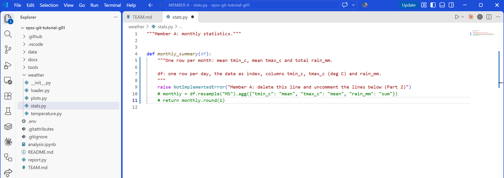

## 2.1 Protect main

First, make the good habit a rule: from now on GitHub refuses any change to `main` that does not come through an approved pull request.

- [ ] **A** On the repository page: **Settings**, then **Rulesets** in the left column, then **New ruleset › New branch ruleset**.

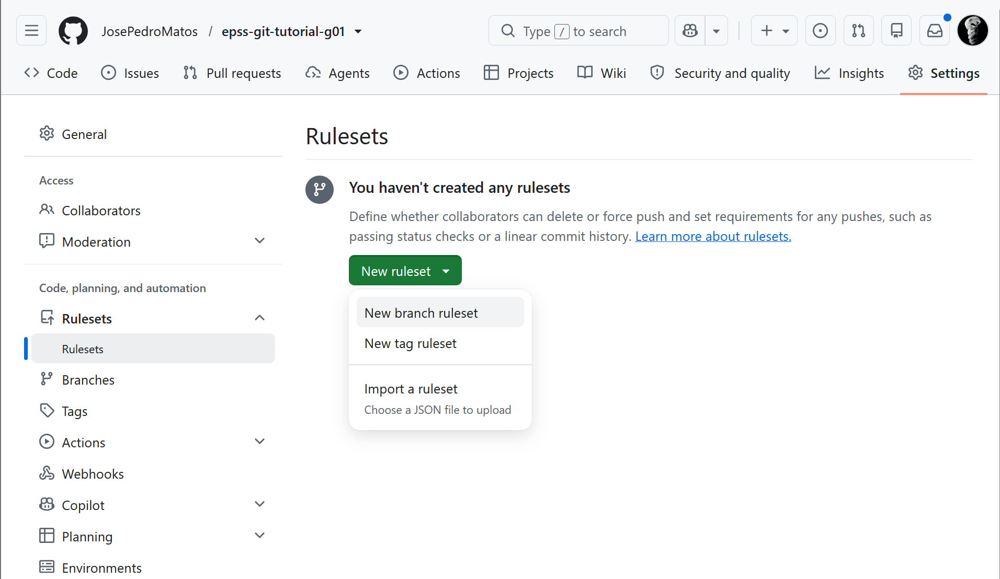

- [ ] **A** *Ruleset Name*: `protect main`. *Enforcement status*: **Active**.
- [ ] **A** Under *Target branches*: **Add target › Include default branch**. *Default* appears in the list.
- [ ] **A** Tick **Require a pull request before merging**. Under it (click **Show additional settings** if it is closed), set **Required approvals** to **1**. Leave the rest as it is. Scroll down and click **Create**.

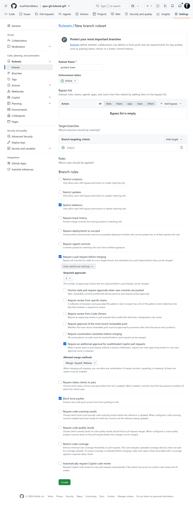

<!-- checkpoint: protected -->
> **Checkpoint 5.** `main` is protected. (Your own computer cannot always see this: the progress page and the Actions tab on GitHub can.)

## 2.2 One branch per task

- [ ] **All** Check that the bottom-left corner says `main`, then **`···` › Pull**, so that you start from the latest version.
- [ ] **All** Click `main` in the bottom-left corner, choose <mark>**Create new branch…**</mark>, type your branch name from the table above, press Enter. The corner now shows your branch.

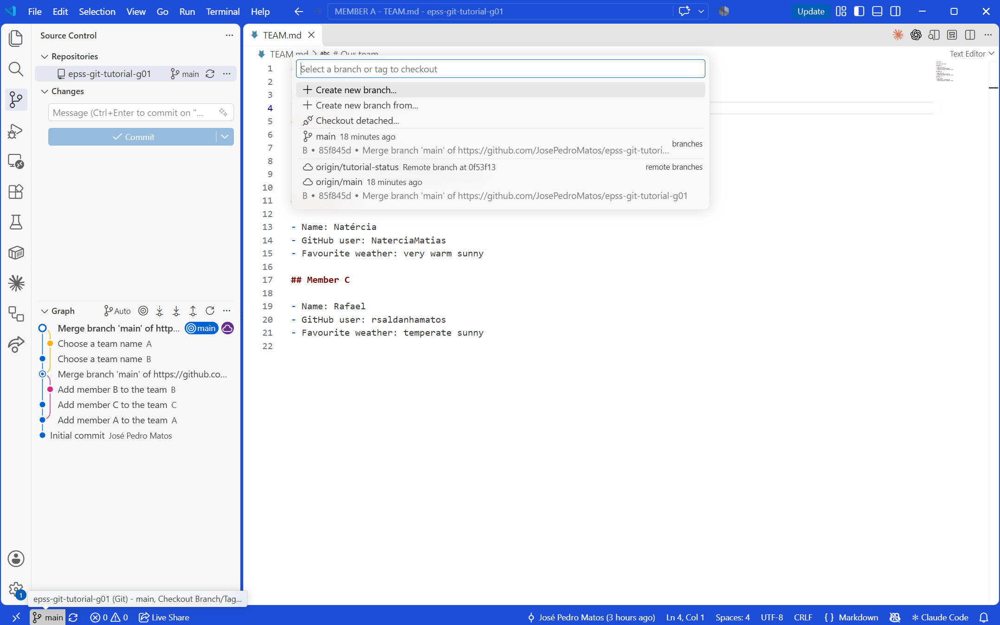

- [ ] **All** Open **your** file from the table (A: `weather/stats.py`, B: `weather/temperature.py`, C: `weather/plots.py`).
- [ ] **All** Delete the whole line `raise NotImplementedError(...)`.
- [ ] **All** Select the comment lines below it, the ones starting with `#`, and choose the menu **Edit › Toggle Line Comment**. The `#` disappear and the code turns coloured: the function is switched on. Save.

A function that nobody calls is of no use. `report.py` is the script that puts the three together.

- [ ] **All** Open `report.py`. Click on the empty line between the two `# --- members` lines and paste **your** two lines there. Save.

  Member A:

  <!-- snippet: report:A -->
  ```python
  from weather.stats import monthly_summary
  print(monthly_summary(df))
  ```

  Member B:

  <!-- snippet: report:B -->
  ```python
  from weather.temperature import add_tmean
  print(add_tmean(df).head())
  ```

  Member C:

  <!-- snippet: report:C -->
  ```python
  from weather.plots import plot_temperature
  print("Plot saved to", plot_temperature(df))
  ```

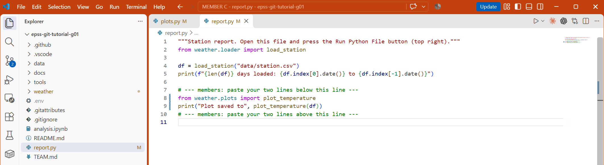

- [ ] **All** With `report.py` open, click the **Run Python File** button (the triangle, top right). The terminal shows the report with your part in it. Test before you commit, always.
- [ ] **C** Your function wrote `outputs/temperature.png`, yet that file does not appear in the Source Control view.

<div class="key" style="background: #fff8c5; color: #1f2328; border-left: 4px solid #d4a72c; border-radius: 6px; padding: 0.1em 1em; margin: 1em 0">

💡 The file `.gitignore` lists what Git must leave out: things the code can make again, and secrets.

</div>

- [ ] **All** Source Control view: two files changed. Read both diffs, stage both (**+**), and commit with a message that says what you did, for example `Add monthly_summary and use it in the report`.
- [ ] **All** Click the blue **Publish Branch** button. Your branch, with its commit, is now on GitHub. `main` has not changed.

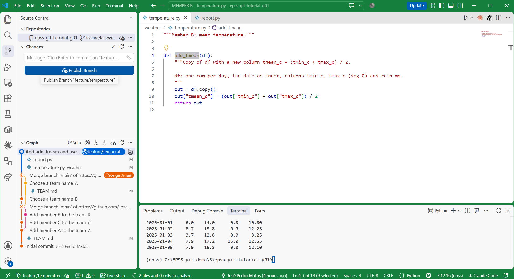

## 2.3 Open a pull request

- [ ] **All** Open the repository page in the browser. A yellow banner mentions your branch: click **Compare & pull request**. (No banner? Tab **Pull requests › New pull request**, and choose your branch under *compare*.)

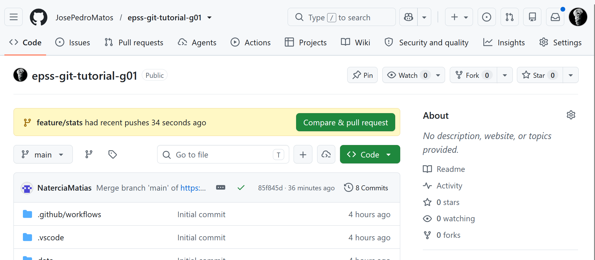

- [ ] **All** The title is your commit message. Add a sentence saying what you tested. On the right, click the gear next to **Reviewers** and choose your reviewer's user name (not *Copilot*): **B reviews A's**, **C reviews B's**, **A reviews C's**. Click **Create pull request**.

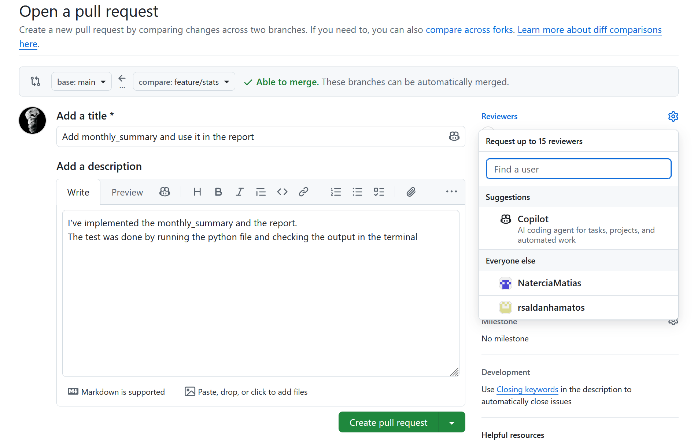

*Reviewers* and *Assignees* are different. A **reviewer** reads the changes and approves them; that approval is what `main`'s rule asks for. An **assignee** is just the person in charge of moving the pull request forward, and changes nothing. Here you only need the reviewer; leave *Assignees* empty.

## 2.4 Review a teammate's pull request

- [ ] **All** Tab **Pull requests** lists all the group's pull requests. To see only the one waiting for you, type `review-requested:@me` in the search box and press Enter (or click **Review requests** in the left column). Open it: **B** gets A's, **C** gets B's, **A** gets C's.

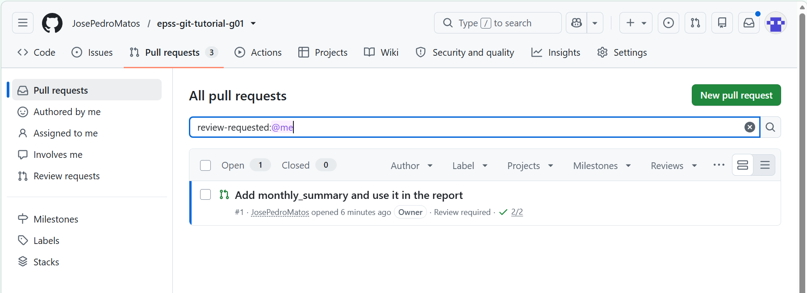

- [ ] **All** Open the tab **Files changed** and read each file's diff: red lines were removed, green lines were added. Tick **Viewed** on each file you have read.

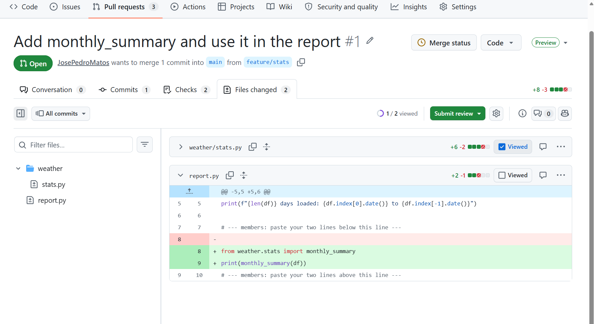

- [ ] **All** Move the mouse over a changed line, click the blue **+**, write a short comment (a question, a suggestion, or what you like about it), and click **Start a review**.
- [ ] **All** Click the green **Submit review** button (top right). Write a short message, choose **Approve**, then click **Submit review** at the bottom.

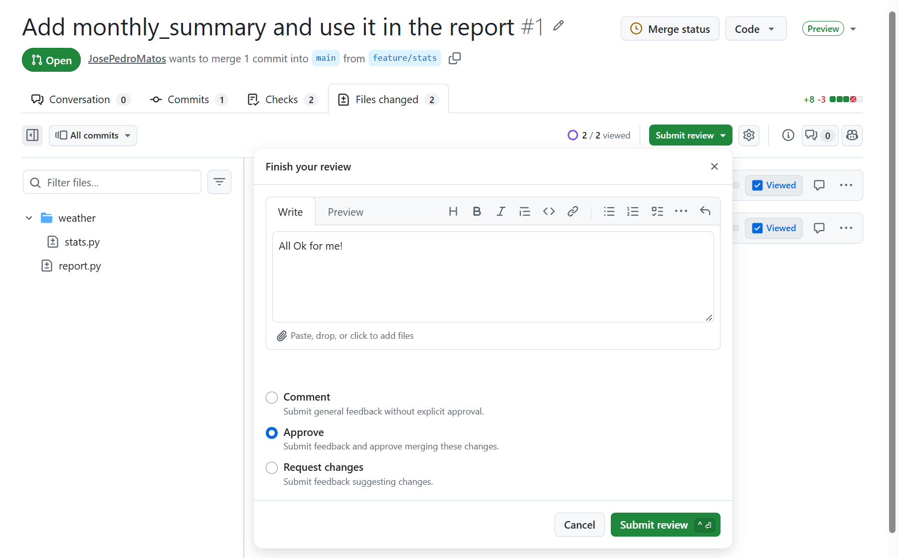

## 2.5 Merge, one at a time

Merge in the order A, B, C. Wait for each other.

- [ ] **A** On your pull request: **Merge pull request › Confirm merge**, then **Delete branch**. Your function is on `main`.

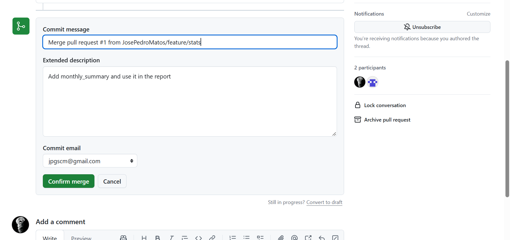

- [ ] **B** Look at your pull request now: *This branch has conflicts that must be resolved*. A's two lines and yours are in the same place of `report.py`. You solve it on your own branch, so `main` is never broken.

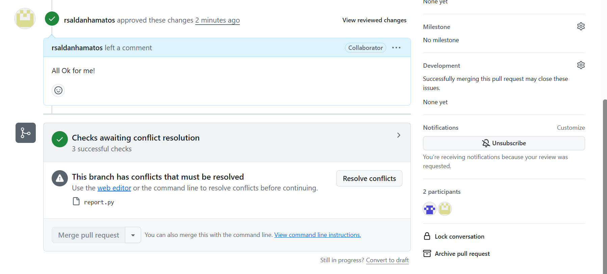

- [ ] **B** In VS Code (the corner shows `feature/temperature`): in the Source Control view, **`···` › Fetch**: VS Code learns what is new on GitHub, without changing your files. Then **`···` › Branch › Merge…** and choose <mark>**origin/main**</mark>, under *remote branches*, with the cloud icon. **Not** `main` at the top of the list: that is your own old copy, without A's work. `origin/main` brings the new `main` from GitHub into your branch.

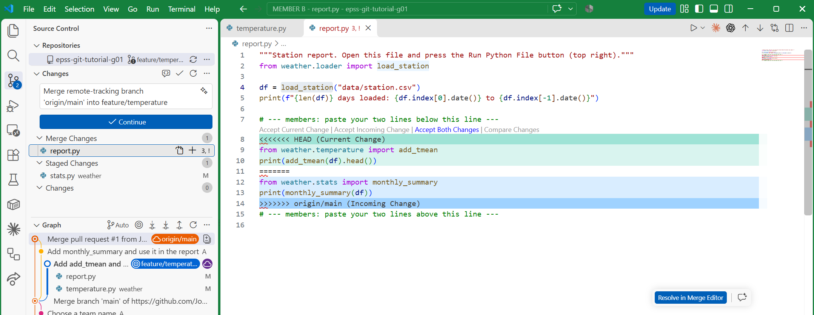

*Shortcut.* The header of the **Graph** (bottom of the Source Control view) has small icons for the same jobs: **Fetch** (arrow down with dots), **Pull** (arrow down onto a line) and **Push** (arrow up). Hover over an icon to see its name. Right after a Fetch, the Graph shows `origin/main` with A's work above your branch: that is what the merge will bring in.
- [ ] **B** `report.py` is under **Merge Changes**. Open it. This time nobody is wrong: both pairs of lines are needed. Click **Accept Both Changes**. Check that no marker line remains, save, and press **Run Python File**: the report shows both parts.


- [ ] **B** Click **+** on `report.py`, then **Continue**, then **Sync Changes**.

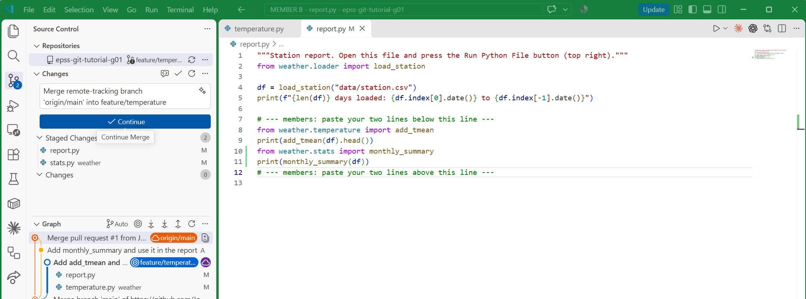
- [ ] **B** Back in the browser, the pull request is green. **Merge pull request › Confirm merge › Delete branch**.
- [ ] **C** Your turn, exactly as B did: **`···` › Fetch**, **`···` › Branch › Merge…** with <mark>**origin/main**</mark>, **Accept Both Changes**, save, run, **+**, **Continue**, **Sync Changes**, then merge your pull request and delete the branch.
- [ ] **All** Go back to `main`: click the branch name in the bottom-left corner and choose `main`, then **`···` › Pull**. Run `report.py`: the three parts are there.
- [ ] **All** Tidy up: **`···` › Branch › Delete Branch…**, and choose your `feature/…` branch. Its commits are safe in `main`.

<!-- checkpoint: prs -->
> **Checkpoint 6.** Three pull requests merged, each approved by a teammate.

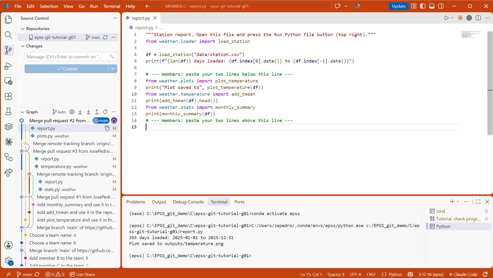

<!-- checkpoint: wired -->
> **Checkpoint 7.** On `main`, `report.py` prints the monthly table, the mean temperature and the plot message.

<details>
<summary style="color: #e5484d">⚠️ <b>If it went wrong</b></summary>

- *Merge pull request is grey*: the approval is missing, or there are conflicts to solve first.
- *You committed on `main` by mistake and the push is refused*: see the first recipe in Part 4.
- *After Accept Both the report fails*: open `report.py` and compare with a teammate's. Between the two marker comments there must be only complete pairs of lines, one pair per member.
- *VS Code will not switch branch ("your local changes would be overwritten")*: commit your changes first.

</details>

**What Part 2 showed.** The same conflict as in Part 1, but this time it stayed on one person's branch until it was solved, someone else read the code before it was accepted, and `main` worked at every moment.

Next: [Part 3 · Notebooks](3-notebooks.md)
